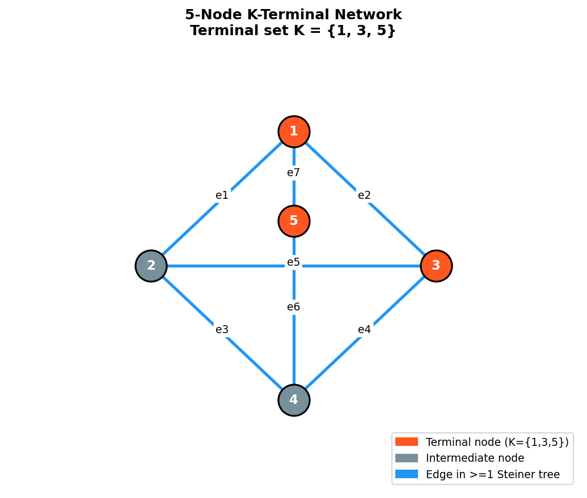
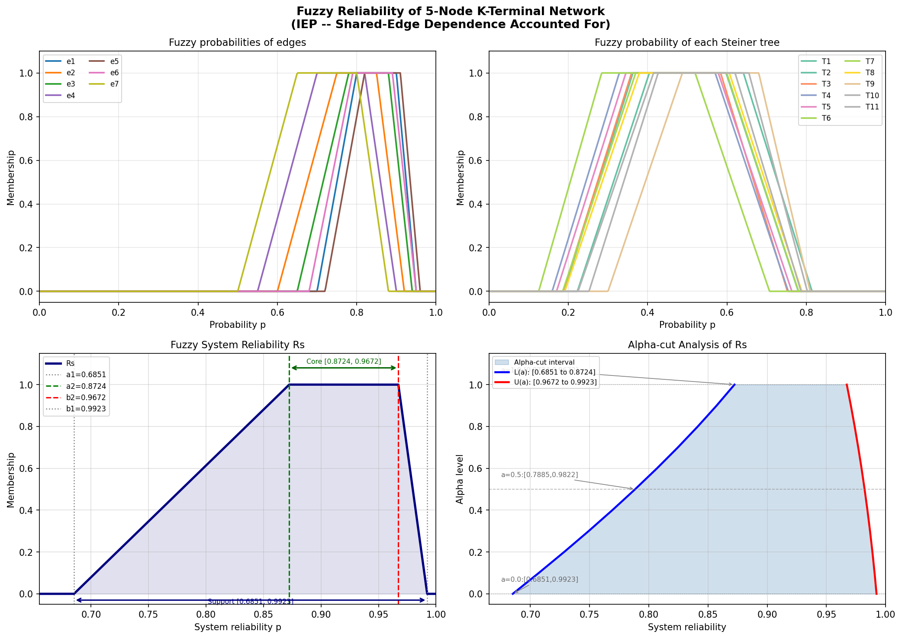
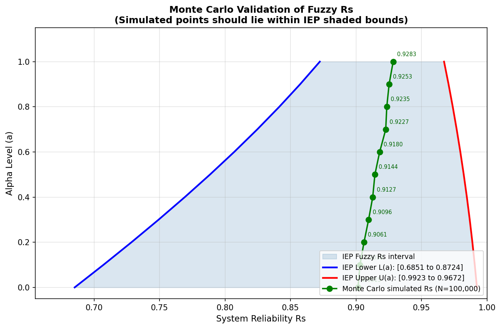

# K-Terminal Fuzzy Network Reliability

Python implementation accompanying the paper **"Modeling K-Terminal Network Reliability Under Uncertainty Using Fuzzy Arithmetic"** (Amarjeet Rajora,Dr. A.S. Baghel, Dr. Isha Singh — Dept. of Computer Science and Engineering, Gautam Buddha University; Micro2026).

The code evaluates the **K-terminal reliability** of a non-series-parallel network when edge reliabilities are not known exactly but are given as **trapezoidal fuzzy numbers**. It extends the fuzzy bridge-network method of Chowdhury & Misra (1992) in one important way: shared edges between minimal Steiner trees are handled with a **corrected Inclusion–Exclusion Principle (IEP)** evaluated at α-cut levels, instead of assuming the trees fail independently.



## What it does

1. **Network and fuzzy edge probabilities.** A 5-node, 7-edge network with terminal set K = {1, 3, 5}. Each edge reliability is a trapezoidal fuzzy number (α₁, α₂, β₂, β₁).
2. **Minimal Steiner tree enumeration.** Brute-force search over all edge subsets, with connectivity checked by graph search and minimality checked by edge removal. The example network has 11 minimal Steiner trees.
3. **Fuzzy system reliability via α-cut IEP.** For every α in [0, 1] (11 levels by default) the lower and upper reliability bounds are computed with crisp inclusion–exclusion, where each intersection term uses the *union of edges* of the trees involved. The fuzzy number Rs = (a₁, a₂, b₂, b₁) is rebuilt as a₁ = L(0), a₂ = L(1), b₂ = U(1), b₁ = U(0).
4. **Monte Carlo validation.** At each α level, edge reliabilities are sampled uniformly from their α-cut interval, a Bernoulli trial decides whether each edge survives, and a graph search tests whether the terminals stay connected. The simulated value is compared with [L(α), U(α)].
5. **Plots.** Network diagram, a four-panel results figure, and a Monte Carlo validation plot.

## Results (default configuration)

| Parameter | Symbol | Value |
|---|---|---|
| Support lower bound | a₁ | 0.6851 |
| Core lower bound | a₂ | 0.8724 |
| Core upper bound | b₂ | 0.9672 |
| Support upper bound | b₁ | 0.9923 |

The Monte Carlo estimates fall inside the analytical interval at all 11 α levels (see `results/`).

| Four-panel analysis | Monte Carlo validation |
|---|---|
|  |  |

## Installation

Requires Python 3.8+.

```bash
git clone https://github.com/<your-username>/kterminal-fuzzy-reliability.git
cd kterminal-fuzzy-reliability
python -m venv .venv
source .venv/bin/activate        # Windows: .venv\Scripts\activate
pip install -r requirements.txt
```

## Usage

```bash
python kterminal_fuzzy_reliability.py
```

This prints the Steiner trees, the α-cut table, the Rs parameters and the Monte Carlo comparison, then saves three figures to `results/`.

Options:

| Flag | Default | Description |
|---|---|---|
| `--trials N` | 100000 | Monte Carlo trials per α level |
| `--seed S` | 42 | Random seed |
| `--no-show` | off | Save figures without opening plot windows (useful on servers) |
| `--output-dir DIR` | `results` | Where to save figures |

The full 100,000-trial run uses a pure-Python simulation loop and can take several minutes. For a quick check:

```bash
python kterminal_fuzzy_reliability.py --trials 10000 --no-show
```

## Using your own network

Edit `build_network()` in `kterminal_fuzzy_reliability.py`:

```python
edges = {'e1': (1, 2), 'e2': (1, 3), ...}          # edge name -> (node, node)
fuzzy_probs = {'e1': TrapezoidalFuzzyNumber(0.70, 0.80, 0.90, 0.95, name='e1'), ...}
terminals = {1, 3, 5}
```

Parameters must satisfy 0 ≤ α₁ ≤ α₂ ≤ β₂ ≤ β₁ ≤ 1. Note that `plot_network()` uses fixed node coordinates for the 5-node example, so update `pos` there for a different topology.

## Code layout

| Item | Purpose |
|---|---|
| `TrapezoidalFuzzyNumber` | Membership function, α-cuts, Tanaka-style product |
| `build_network()` | Edges, fuzzy edge probabilities, terminal set |
| `find_minimal_steiner_trees()` | Enumerates minimal edge sets connecting K |
| `inclusion_exclusion_at_alpha()` | Crisp IEP at one α level and bound |
| `compute_kterminal_fuzzy_reliability_correct()` | α-cut scan and reconstruction of Rs |
| `monte_carlo_validate()` | Monte Carlo check against the IEP interval |
| `plot_*` | Figures |

## Notes and limitations

- **Complexity.** Steiner tree enumeration is O(2^|E|) and IEP is O(2^M) in the number of trees M (2¹¹ = 2048 terms here). This is fine for small networks but does not scale to large ones without a different method.
- **Tree labels.** Steiner trees are sorted by size and edge names so labels T1–T11 are reproducible. This numbering can differ from Table II in the paper; the trees themselves are identical.
- **Trapezoidal reconstruction.** Rs is reported as a trapezoid built from the α = 0 and α = 1 cuts. The exact L(α) and U(α) curves are slightly non-linear, as the α-cut plot shows.
- **Tree-level plots.** Per-tree fuzzy probabilities (top-right panel) use the interval product of Tanaka et al., an approximation that is accurate for probabilities in [0.5, 1].
- **Monte Carlo scope.** The simulation checks that sampled reliabilities lie within the analytical bounds; it is a consistency check rather than an independent estimate of the fuzzy number's shape.

## References

1. S. G. Chowdhury and K. B. Misra, "Evaluation of fuzzy reliability of a non-series parallel network," *Microelectronics Reliability*, vol. 32, no. 1–2, pp. 1–4, 1992.
2. H. Tanaka, L. T. Fan, F. S. Lai, and K. Toguchi, "Fault tree analysis by fuzzy probability," *IEEE Trans. Reliability*, vol. R-32, no. 5, pp. 453–457, 1983.
3. L. A. Zadeh, "Fuzzy sets," *Information and Control*, vol. 8, no. 3, pp. 338–353, 1965.

## Citation

If you use this code, please cite the paper (see `CITATION.cff`):

> A. Rajora, A. S. Baghel, and I. Singh, "Modeling K-Terminal Network Reliability Under Uncertainty Using Fuzzy Arithmetic," 13th Int. Conf. on Microelectronics, Circuits and Systems (Micro2026), 2026.

## License

Released under the MIT License — see [LICENSE](LICENSE).
